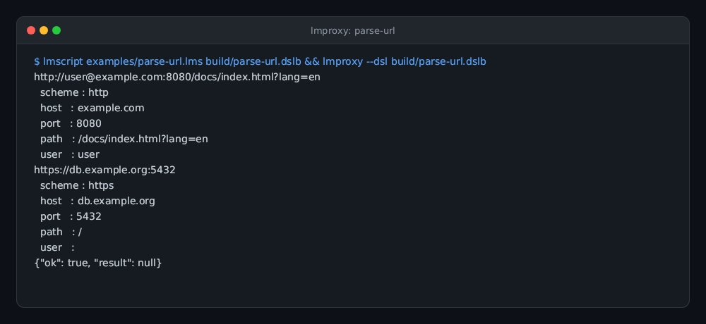
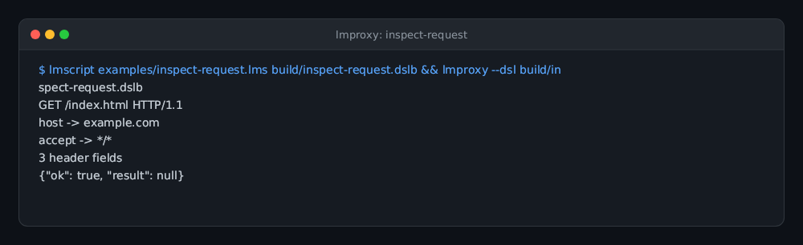
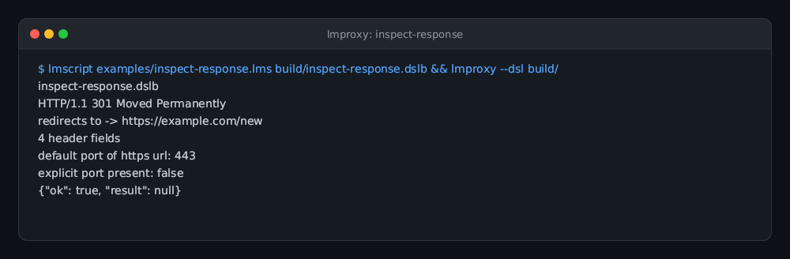
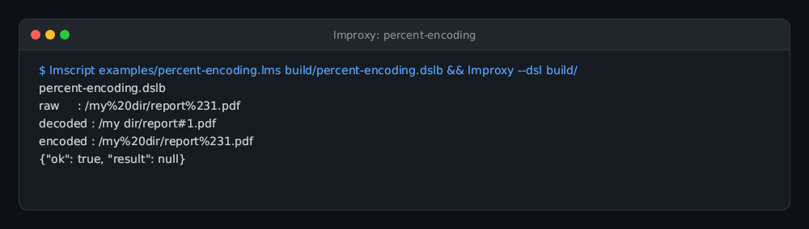
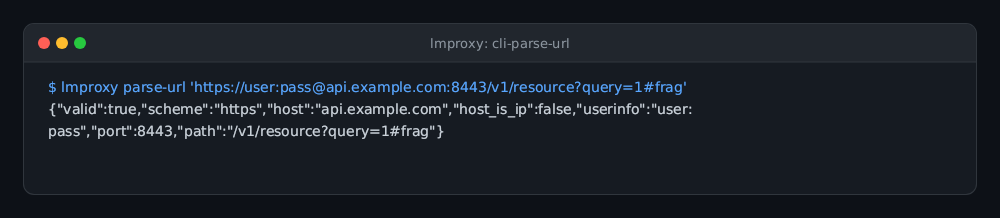
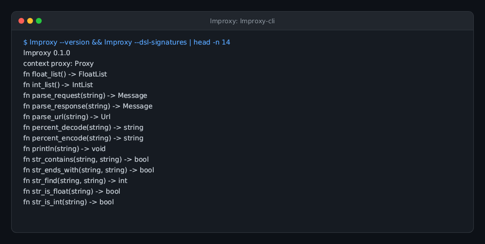

# lmproxy

Squid's HTTP and URL machinery as a single statically-linked, scriptable CLI —
not a proxy server.

lmproxy wraps the [Squid](https://www.squid-cache.org) 7 parsing engine (URL
parser, HTTP/1.1 request/response parsers) in one dependency-free executable
that can be driven from the command line or scripted with
[lmscript](https://github.com/lmctl-ai). It exists for debugging and research:
inspect how Squid interprets URLs and HTTP messages without running a daemon
or writing a config file.

## Build

```sh
scripts/sync-squid.sh   # download the pinned Squid source (third_party/, git-ignored)
cmake -S . -B build -G Ninja -DCMAKE_BUILD_TYPE=Release
cmake --build build
```

Produces `build/lmproxy`: one statically linked executable (`ldd` reports
"not a dynamic executable" on Linux; macOS links only system libraries).

## CLI

```
lmproxy --version
lmproxy --dsl-schema [--json]
lmproxy --dsl-signatures
lmproxy parse-url URL...
lmproxy parse-request FILE   # HTTP/1.x request message
lmproxy parse-response FILE  # HTTP/1.x response message
lmproxy --dsl FILE [FILE ...]
```

The `parse-*` commands are the simple entry points; the `--dsl` interface
runs lmscript bytecode against the same engine with structured access to
parsed objects.

## Scripting

```lmscript
p = _dsl_ cli="lmproxy" install="github:lmctl-ai/lmproxy@latest";
let u = proxy.parse_url("http://user@example.com:8080/a?b=1");
println(u.host() + ":" + str(u.port()) + u.path());
end _dsl_
savedsl(p, "build/show.dslb");
```

See `examples/` for runnable scripts.

## Gallery

| **URL parsing & decomposition** | **Request message inspection** | **Response status & redirect** |
| --- | --- | --- |
|  |  |  |
| Extract scheme, host, port, path, and userinfo using Squid 7 URL parser.<br>`lmctl autorun https://raw.githubusercontent.com/lmctl-ai/lmproxy/main/examples/parse-url.lms` | Parse HTTP/1.1 request lines and inspect header fields.<br>`lmctl autorun https://raw.githubusercontent.com/lmctl-ai/lmproxy/main/examples/inspect-request.lms` | Parse HTTP/1.1 response status code, headers, and chase Location redirects.<br>`lmctl autorun https://raw.githubusercontent.com/lmctl-ai/lmproxy/main/examples/inspect-response.lms` |

| **Percent-encoding** | **CLI parse-url JSON** | **lmproxy CLI & Schema** |
| --- | --- | --- |
|  |  |  |
| Percent-decode and re-encode URL path components.<br>`lmctl autorun https://raw.githubusercontent.com/lmctl-ai/lmproxy/main/examples/percent-encoding.lms` | CLI URL parsing emitting structured JSON for shell automation.<br>`lmproxy parse-url <URL>` | Embedded Squid 7 engine and strongly typed DSL signatures.<br>`lmproxy --version && lmproxy --dsl-signatures` |

## Repository layout

- `cpp/` — the CLI host: DSL VM integration plus the Squid wrapper
- `schema/lmproxy.dsl.json` — the DSL schema (embedded into the binary)
- `examples/` — lmscript examples
- `scripts/` — vendoring (Squid source, lmcode-cpp SDK) and compiler selection
- `third_party/` — downloaded upstream sources (git-ignored, pinned by `squid.lock`)

## License and company

lmproxy-authored code is MIT licensed (see `LICENSE`). It builds against
Squid, which is GPLv2+; the compiled executable is a combined work under
GPLv2+ (`THIRD_PARTY_NOTICES.md`). Made by **Lattice Systems LLC**.
